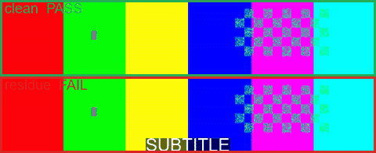

# takecheck

[](https://github.com/yqyq-ai/takecheck/actions/workflows/ci.yml)

**pytest for AI-generated video.** Turn “is this take usable?” into an executable spec and a CI gate.

> **Status: v0.1.0 — published on [PyPI](https://pypi.org/project/takecheck/).**
> Spec compliance plus frozen / duplicate / blank / flicker / motion / subtitle residue / audio,
> with a self-contained HTML report.

## Why

A 20-minute render should not be judged by scrubbing frames by hand. `takecheck` reads a `takes.yml`
spec, compares the delivered file against it, and returns **pass / fail + the reason** — in seconds,
on CPU, while the GPU is still rendering.

Generation pipelines fail in ways a thumbnail cannot show: a shot freezes for 300 ms, the camera starts
flickering, the reference clip’s burned-in subtitles survive the redraw, the audio track silently
disappears, the last frame of segment 3 does not match the first frame of segment 4. Each is cheap to
detect and expensive to discover after a 20-minute render — or after stitching the whole film.

Existing tools do not cover this layer: VMAF/DOVER/DVQA score perceptual quality against a reference
or a learned aesthetic prior, VideoGen-Eval is an LLM-API research harness, and ComfyUI QC nodes check
tensors inside a graph instead of the delivered file.

## Install

```bash
pip install takecheck
```

Requires `ffmpeg` / `ffprobe` on `PATH`. No PyTorch, no GPU — `numpy` is the only numeric dependency.

## Quick start

`takes.yml`:

```yaml
name: h3-ep12-shot03
expect:
  duration: 5.0
  fps: 24
  frames: 121
  resolution: 1280x720
  audio: required
  subtitles: forbidden
  frozen_max_ms: 200
  black_max_frames: 0
  flicker_max: 0.35
  motion_min: 0.002
```

```bash
takecheck check out/shot03.mp4 --spec takes.yml --json report.json --html report.html
```

```console
FAIL  h3-ep12-shot03  (shot03.mp4)
  PASS  spec      1280x720 | 24fps | 121f | 5.04s
  FAIL  frozen    1 frozen stretch(es) over 200ms: 0.00-0.83s (longest 833ms)
  PASS  duplicate 0/120 frames replay an earlier frame (0.0%)
  PASS  blank     0 blank frame(s), luma 12-241
  PASS  flicker   worst 5-frame luma swing 9/255 (3.5% <= 35%)
  PASS  motion    mean frame-to-frame motion 0.0412 >= 0.0020
  PASS  subtitle  no persistent text band (row contrast 1.28 < 2 on 0% of frames)
  PASS  audio     peak -3.2 dB, -18.4 LUFS, 0% silent
```

Add `--html report.html` for a self-contained report: a contact sheet with failing moments outlined in
red, every measured value, and the raw JSON inline. No external assets, so it can be emailed or
attached to a PR as a single file.

Exit codes: `0` pass, `1` fail, `2` bad spec / unreadable file.

### What the checks measure

Every check reports the numbers behind its verdict in `--json` and `--html`, not just PASS/FAIL.

| Check | Signal | Fails when |
|---|---|---|
| `frozen` | pHash Hamming distance between consecutive frames | ≤ 3 for longer than `frozen_max_ms` |
| `duplicate` | repeated frame hashes, ignoring neighbours, blanks and freezes | more than 1% of frames replay an earlier one |
| `blank` | mean luma per frame | below 16 or above 240, more than `black_max_frames` |
| `flicker` | peak-to-peak luma inside a 5-frame window | above `flicker_max` (fraction of 0–255) |
| `motion` | mean absolute frame-to-frame difference | below `motion_min` |
| `subtitle` | busiest row's horizontal activity ÷ that band's median row | above 2.0 on ≥ 30% of frames, when `subtitles: forbidden` |
| `audio` | peak dBFS, EBU R128 loudness, silent fraction | peak ≥ −0.1 dBFS, or more than 60% silent |

Three design choices worth knowing:

- **One defect, one check.** A cut to black is reported by `blank` only; `duplicate` skips blank frames,
  and `flicker` skips windows containing them. A freeze is reported by `frozen`, and `duplicate` ignores
  frames a freeze already explains. A missing audio track is reported by the spec check, so `audio`
  stays quiet about it instead of failing twice for one problem.
- **`motion` is exempt on purpose.** It is a whole-clip aggregate ("does this clip move at all"), not an
  event with a timestamp, so it may legitimately co-fire with a local check: a fully black clip really
  is both blank and motionless.
- **Thresholds are calibrated, not guessed.** `motion_min` defaults to `0.002` because a normally moving
  clip measures ≈ 0.009 and a still render ≈ 0.000 on the bundled fixtures. Real footage differs — set
  the values in `takes.yml` for your own pipeline.
- **Deliberately slow shots read as still.** A clip slowed down 8x measures `mean_motion ≈ 0.0010` and
  will fail the default `motion_min` of `0.002`. If your pipeline uses slow motion or static
  compositions on purpose, lower `motion_min` (or set it to `0`) in `takes.yml`.

### Known limitations

- **The `subtitle` check has only been validated on synthetic footage.** Its fixtures use a hard white
  bar on black. Real subtitle ghosts are semi-transparent and blurred, and a scene that legitimately
  contains text in the lower third will trip the check. Treat the default threshold as a starting
  point, not a calibrated value.
- **Loudness is reported, not enforced.** Only clipping and excessive silence fail the audio check;
  a quiet or hot mix is recorded under `measured` for you to judge.
- **Long clips are untested.** Decoding is streamed, so memory should stay flat, but a 20-minute render
  has not been benchmarked.

## Roadmap

- [x] v0.0.1 — spec format, ffprobe compliance check, CLI, `takecheck selftest`
- [x] v0.1.0 — frozen / duplicate / blank / flicker / motion / subtitle / audio, HTML report, on PyPI
- [x] ComfyUI node — drop it after a sampler, branch on `pass`
- [ ] v0.2.0 — calibration against accepted/rejected takes, head/tail continuity
- [ ] v0.3.0 — pipeline lint (custom-node provenance, model hash pinning)
- [ ] v0.4.0 — pluggable VLM judge

## ComfyUI

`comfyui/` holds a node that runs these checks on the `IMAGE` batch you just
generated. It reuses this package — no check logic is duplicated — and runs on
the CPU while your GPU keeps sampling.



```bash
cmd /c mklink /J "<ComfyUI>\custom_nodes\ComfyUI-TakeCheck" "<repo>\comfyui"
"<ComfyUI>/../python/python.exe" -m pip install takecheck
```

Restart ComfyUI; the node appears under **video/validation → TakeCheck**.
Outputs are `pass` (BOOLEAN), `verdict`, `report` (path) and `detail` (the
failing checks in one line). See [`comfyui/README.md`](comfyui/README.md) for the
spec options, and run `python comfyui/TakeCheck.py` to self-test without ComfyUI.

## Test media

`testmedia/synthetic/` holds seven tiny clips that each reproduce exactly one defect — frozen frames,
duplicate frames, blank frames, flicker, missing audio, burned-in subtitles — plus `good.mp4` as the
control that must always pass. Rebuild them with:

```bash
python scripts/make_testmedia.py
```

The script also verifies each clip against its expected profile (duration, frame count, audio) and
runs in CI, so the fixtures cannot silently rot. A second script asserts the *verdict* for each one:

```bash
python scripts/check_synthetic.py
```

It fails if `good.mp4` trips any check, or if a defect clip stops being caught — so a threshold change
cannot quietly break detection.

Real footage never goes in the repository: `testmedia/real/` is git-ignored.

## Development

```bash
pip install -e ".[dev]"
pytest -q
takecheck selftest            # builds synthetic clips in a temp dir; needs ffmpeg
python scripts/check_synthetic.py
```

Note for contributors on Windows: `drawtext` needs an explicit `fontfile=`, otherwise ffmpeg aborts
with a Fontconfig error instead of drawing anything. The test helpers search a list of common font
paths for this reason.

## 中文简介

`takecheck` 是给 AI 生成视频用的**验收层**：用 `takes.yml` 声明一条片子该满足什么（时长、帧率、
无静帧、无字幕残影、音轨完整），一条命令返回通过与否和原因，可直接当 CI 门禁。
全程 CPU、秒级，能与渲染并行，不占显存。

## License

MIT.
