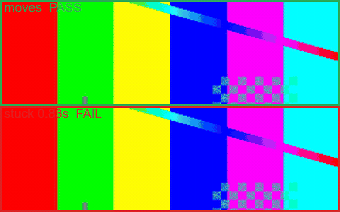

# ComfyUI-TakeCheck

A ComfyUI node that runs [takecheck](https://pypi.org/project/takecheck/) on the take you
just generated, and turns "is this usable?" into a pass/fail you can branch on.

Drop it after your video sampler. It encodes the `IMAGE` batch to a temporary
clip and runs the same checks the `takecheck` CLI runs — no check logic is
duplicated here, so the node and the command line can never disagree.

**Everything runs on the CPU.** The frames are already in RAM when the node
runs; the checks are numpy and ffmpeg only. Nothing is added to the GPU, and you
can keep sampling while a previous take is being checked.




## Install

### From the ComfyUI Manager (recommended)

Search for **TakeCheck** in *Manager → Install Custom Nodes*, install, restart
ComfyUI.

### Manually

```bash
git clone https://github.com/yqyq-ai/takecheck
```

Then link (or copy) the `comfyui` subfolder into `custom_nodes`:

```powershell
# Windows, from the repository root
cmd /c mklink /J "<ComfyUI>\custom_nodes\ComfyUI-TakeCheck" "<repo>\comfyui"
```

```bash
# Linux / macOS
ln -s "<repo>/comfyui" "<ComfyUI>/custom_nodes/ComfyUI-TakeCheck"
```

Install the Python dependency **into ComfyUI's own interpreter**, not your
system Python:

```bash
"<ComfyUI>/../python/python.exe" -m pip install takecheck   # portable build
# or, for a plain venv install:
python -m pip install takecheck
```

Restart ComfyUI. The node appears under **video/validation → TakeCheck**.

## What it checks

| Check | Fails when |
|---|---|
| `spec` | duration / fps / frames / resolution / audio do not match `takes.yml` |
| `frozen` | the picture stops changing for longer than `frozen_max_ms` |
| `duplicate` | more than 1% of frames replay an earlier frame |
| `blank` | any frame is essentially black or blown out |
| `flicker` | brightness swings more than `flicker_max` within a few frames |
| `motion` | the clip is nearly static (`motion_min`) |
| `subtitle` | a band of text sits in the bottom 72–92% of the frame |
| `audio` | the track is clipped or mostly silent |

Each check reports the numbers behind its verdict in the JSON report, so a
failure explains itself.

**One blind spot: `flicker` is less sensitive here than on the command line.**
ComfyUI hands over `IMAGE` as clamped RGB. A take whose brightness was pushed
past 0/255 in YUV arrives with the swing already squashed — the bundled
`flicker.mp4` fixture measures a 53% swing through the CLI and 31% through the
node, landing just under the 35% threshold. A real exposure flicker, which lives
in RGB, is still caught (verified). If you rely on flicker detection, also run
`takecheck` on the saved file.

A **malformed spec raises an error** instead of returning a verdict. An unknown
key, an out-of-range threshold or broken YAML is a mistake in your config, not a
bad take — the node raises `ValueError` so you can tell the two apart.

## Outputs

| Output | Type | Meaning |
|---|---|---|
| `pass` | `BOOLEAN` | true when every check passed |
| `verdict` | `STRING` | `"pass"` or `"fail"` |
| `report` | `STRING` | path to the JSON report (and HTML, if enabled) |
| `detail` | `STRING` | one line per failing check |

Wire `pass` into a *Conditioning / switch* node to reject bad takes
automatically, or just read `detail` in the console.

## The spec

Point the `spec` widget at a `takes.yml`. A starter file ships next to this
node (`takes.yml`); copy it and edit the thresholds for your pipeline.

```yaml
name: comfy-take
expect:
  audio: optional
  subtitles: forbidden
  frozen_max_ms: 200
  black_max_frames: 0
  flicker_max: 0.35
  motion_min: 0.002
```

Two things worth knowing:

- **`motion_min` is calibrated, not guessed.** A normally moving clip scores
  about `0.009`, a still one about `0.000`. Deliberately slow shots read as
  still — lower `motion_min` (or set it to `0`) if you use slow motion.
- **`subtitles: forbidden` will flag a scene that legitimately contains text in
  the lower third.** Set it to `allowed` for titles and lower-thirds.

The clip is encoded at `crf 12` before checking, deliberately near-lossless: a
heavy encode blurs frame differences and makes `frozen` and `motion` lie.

Frame dimensions must be even in both axes (ffmpeg's `yuv420p` needs it).
The node says so explicitly instead of producing a corrupt file.

## Verifying the install

```bash
"<python>" "<ComfyUI>/custom_nodes/ComfyUI-TakeCheck/TakeCheck.py"
```

Runs seven checks without needing ComfyUI or a GPU: a moving batch passes, a
frozen batch fails, the JSON and HTML reports are written, a single-frame batch
is handled, odd sizes and a missing spec are rejected with clear messages.

## License

MIT.
